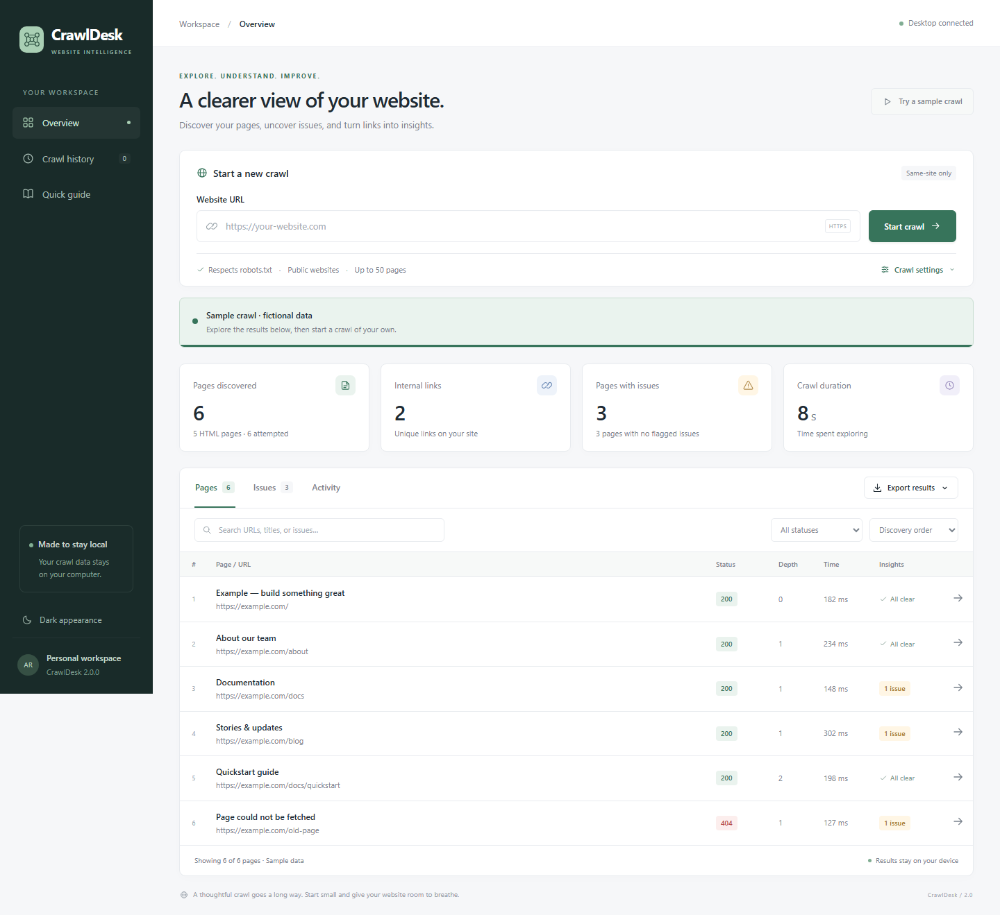

# CrawlDesk

A modern desktop workspace for exploring public websites. Discover pages and internal links, review page metadata, find common content issues, and export a report — all from a local Python application.

Built with **pywebview**, HTML/CSS/JavaScript, and a Python standard-library crawl engine. No cloud account or frontend build step is required.



## Features

- Responsive desktop interface with light and dark appearances.
- Live page, link, issue, and duration metrics; progress and activity feed.
- Background crawling with pause, resume, and stop; partial results are retained.
- Search, status filtering, and sorting by URL, issues, or fetch duration.
- Page inspector with title, description, H1 headings, canonical tag, image metadata, and internal links.
- Review hints for missing titles/descriptions/H1s, long titles, multiple H1s, missing image alt attributes, and HTTP/fetch errors.
- Configurable page limit, link depth, request delay, timeout, response size, and excluded path patterns.
- Automatically saved local crawl history, including stopped and failed runs.
- CSV, JSON, and JSONL export through a native Save dialog. Existing export files are protected from overwrites. CSV cells are escaped to prevent page content from becoming spreadsheet formulas.
- Clearly labeled fictional sample data for exploring the interface without network requests.
- Existing command-line crawling remains available without third-party dependencies.

## Install and run on Windows

**Portable app:** Download `CrawlDesk-2.0.0-windows-x64.zip` from [GitHub Releases](https://github.com/Arjunren/CrawlDesk/releases/latest), extract it, and open `CrawlDesk.exe`. Python is bundled. The release includes instructions, an MIT license, and SHA-256 checksums. Requires Windows 10/11 x64, Edge WebView2 Runtime, and .NET Framework 4.8 or newer; the executable is unsigned.

**Run from source:**

Requires **Python 3.11+** and the **Microsoft Edge WebView2 Runtime**, normally present on modern Windows systems. Tested on Windows with Python 3.14 and pywebview 6.2.1 using the Edge Chromium renderer.

In PowerShell, from the project folder:

```powershell
py -3 -m venv .venv
.\.venv\Scripts\python.exe -m pip install -r requirements.txt
.\.venv\Scripts\python.exe desktop.py
```

After setup, double-click **launch.bat** to open the app. For debug tools, run `desktop.py --debug`.

Alternatively, `powershell -ExecutionPolicy Bypass -File setup.ps1` creates the virtual environment and installs the desktop dependencies. The script checks each step and leaves launching to you.

On macOS/Linux, create and activate a Python virtual environment, install `requirements.txt`, and run `python desktop.py`. These platforms need their native webview dependencies; see the [pywebview installation guide](https://pywebview.flowrl.com/guide/installation.html). Desktop rendering on macOS/Linux has not been tested in this workspace.

## Your first crawl

1. Enter a full public URL such as `https://example.com/`.
2. Optionally expand **Crawl settings**. The default is 50 pages, depth 5, and a one-second request delay.
3. Select **Start crawl**. Pages appear as requests finish. Pause/resume between requests or stop and keep partial results.
4. Search or filter the Pages/Issues tabs; select a row to inspect a page.
5. Select **Export results** for CSV, JSON, or JSON Lines. Open **Crawl history** to revisit saved reports.

Excluded paths use case-sensitive path globs, one per line:

```text
/admin/*
/account/*
```

Depth 0 fetches only the starting page. Metadata insights are review hints, not a complete SEO or accessibility audit. Blank `alt=""` is allowed for decorative images; only absent alt attributes are flagged. Fetch duration includes any rate-limit wait before the request.

## Data and behavior

Crawl reports stay on your computer. On Windows, reports are saved in `%LOCALAPPDATA%\CrawlDesk`; the fallback on other platforms is `~/.local/share/CrawlDesk`. Each run has a unique identifier and two files: a `.json` desktop report (including error records and logs) and a `.jsonl` stream of successful HTML pages. History reloads reports across app restarts. The sample is not saved to history. Export includes every displayed result record, including fetch errors; it exports the full result set rather than the currently filtered subset.

The engine traverses breadth-first and stays on the starting scheme, hostname, and default port. It reads `/robots.txt`, observes Disallow and Crawl-delay via Python's `urllib.robotparser`, limits redirects, page counts, response sizes, discovered links, and queue size, and stops on HTTP 429/503. It connects only to verified public IPs and validates HTTPS certificates. Crawl exclusions also apply to redirect targets.

Pause and stop are cooperative: an in-progress request finishes or times out first. Delays (including long robots crawl delays) are interruptible. Closing the window requests cancellation and retains a snapshot of partial results. If the process is forcibly terminated or the computer loses power, the successful-page JSONL stream may be available while the final history report is incomplete.

The engine does not execute website JavaScript, sign in, solve captchas, or parse PDFs. DNS lookup itself is not bounded by the socket timeout. `urllib.robotparser` is not a full RFC 9309 implementation. Use the tool on sites you are authorized to crawl and follow the site's rate policies.

## Command line

The CLI requires only Python's standard library:

```powershell
python crawler.py https://example.com/ --max-pages 20 --delay 1.0 --max-depth 3 --exclude '/admin/*' --output pages.jsonl
```

Use `python crawler.py --help` for all options. The output directory must exist and the output file must be new. The CLI writes one record per successful HTML page. Records contain URL, HTTP status, title, H1, description, canonical tag, image counts, issues, depth, duration, response bytes, link count, and normalized internal links.

## Development and verification

Backend tests are independent of desktop dependencies and use deterministic fixtures:

```powershell
python -m unittest discover -s tests -v
```

Browser acceptance checks use the real Python API with mocked website responses:

```powershell
.\.venv\Scripts\python.exe -m pip install -r requirements-dev.txt
.\.venv\Scripts\python.exe -m playwright install chromium
.\.venv\Scripts\python.exe tools/verify_ui.py
.\.venv\Scripts\python.exe tools/verify_native.py
```

`verify_ui.py` checks sample data, search/filter/sort, inspection, themes, export, a worker crawl, pause/resume, history, activity, HTML escaping, and responsive layout. Its screenshots go to the ignored `artifacts/` folder. `verify_native.py` checks the actual pywebview renderer and JavaScript bridge in a hidden desktop window; run this on a machine with an available desktop renderer. GitHub Actions runs backend tests on Windows/Linux and Python 3.11/3.14.

## Project structure

```text
crawler.py                 Crawl engine and CLI
desktop.py                 Desktop launcher, worker, history, and export API
ui/                        Local HTML, CSS, and JavaScript interface
tests/                     Backend regression tests
tools/                     Browser and native renderer acceptance checks
launch.bat                 Windows launcher
setup.ps1                  Windows environment setup
tools/build_release.py     Verified Windows executable and ZIP packaging
```

## Build a Windows release

On Windows x64, install `requirements-build.txt` into the virtual environment and run:

```powershell
.\.venv\Scripts\python.exe -m pip install -r requirements-build.txt
.\.venv\Scripts\python.exe tools/build_release.py
```

The build bundles the UI assets and Python runtime, executes the frozen app in a hidden window, verifies the native renderer, bridge, sample results, exports, and local storage, and then writes the executable, portable ZIP, build manifest, and checksums to `dist/`. The manifest records the source commit. The icon is an original CrawlDesk brand asset.

## License

[MIT](LICENSE) © 2026 Arjunren.
